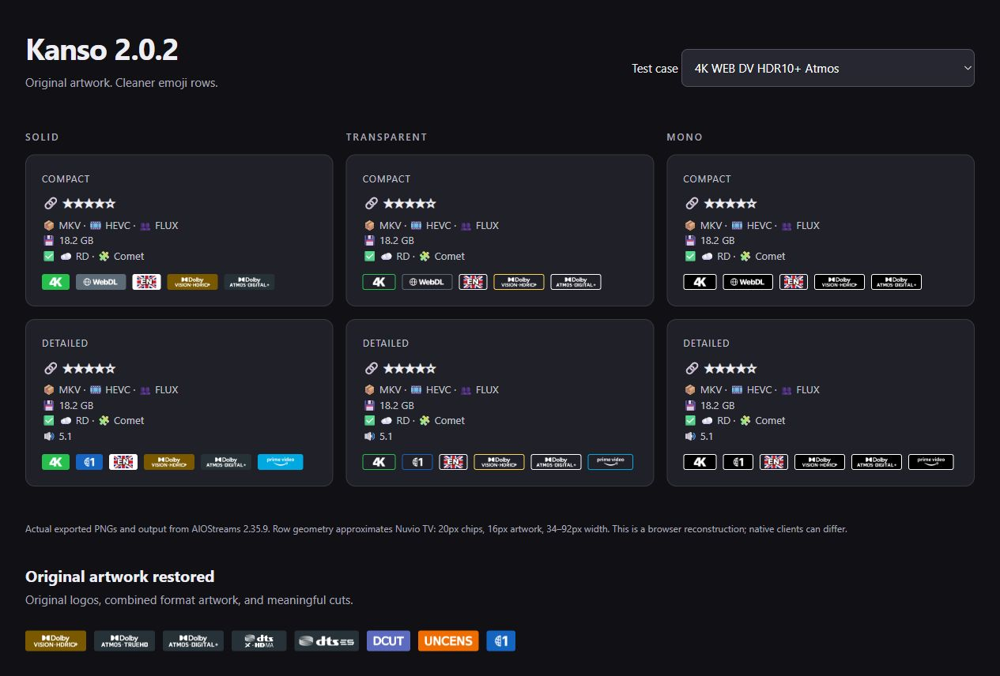

<p align="center"></p>

# Kanso 2.1.0

Illustrated stream badges and an emoji formatter for Nuvio + AIOStreams. Audio language lives in one formatter row, with native Unicode flags, without ISO language codes; the duplicate flag badges are retired. Original logos, transport icons, stars and emoji rows are preserved. **Compact is the default. Detailed adds provenance.** Both come in Solid, Transparent and Mono.



This preview uses exported PNGs and real AIOStreams output. Its browser layout approximates Nuvio TV badge dimensions; it is not a screenshot of an installed Nuvio client.

## Choose a matching pair

| Preset | AIOStreams formatter | Solid badges | Transparent badges | Mono badges |
|---|---|---|---|---|
| **Compact** | [formatter.json](https://raw.githubusercontent.com/nosvasedis/Kanso/main/formatter.json) | [Solid](https://gist.githubusercontent.com/nosvasedis/7abd79424bb8981b511838524c52f097/raw/kanso-solid.json) | [Transparent](https://gist.githubusercontent.com/nosvasedis/63b769d205bddbbef79faf8beef53c28/raw/kanso-transparent.json) | [Mono](https://gist.githubusercontent.com/nosvasedis/1858e332fef11d136f76c697ea6c7439/raw/kanso-mono.json) |
| **Detailed** | [formatter-detailed.json](https://raw.githubusercontent.com/nosvasedis/Kanso/main/formatter-detailed.json) | [Solid Detailed](https://gist.githubusercontent.com/nosvasedis/7abd79424bb8981b511838524c52f097/raw/kanso-solid-detailed.json) | [Transparent Detailed](https://gist.githubusercontent.com/nosvasedis/63b769d205bddbbef79faf8beef53c28/raw/kanso-transparent-detailed.json) | [Mono Detailed](https://gist.githubusercontent.com/nosvasedis/1858e332fef11d136f76c697ea6c7439/raw/kanso-mono-detailed.json) |

## Install or upgrade

1. Use **AIOStreams 2.35.9 or later**. Kanso 2 is verified against the official 2.35.9 engine. Older engines can lack the track operations this formatter needs.
2. In AIOStreams, select the custom formatter and import/sync the formatter URL for your preset, where supported. Alternatively paste its `name` and `description` separately. The exact paste strings are supplied in `formatter-export-name.txt` and `formatter-export-description.txt`, or their `formatter-detailed-…` equivalents.
3. Set your preferred audio languages in AIOStreams. Kanso reads those preferences.
4. In a Nuvio client that supports importing custom badge packs, replace the old Kanso pack with the matching **badge file** from the table. Retired flags/score/channel filters are removed from the JSON; merging with an old imported pack can leave those old entries behind. Each gist now contains both presets: choose the correct filename. Turn off the old Kanso filters before importing, or replace the old pack, so two versions cannot display together.
5. For an upgrade from Kanso 1, **refresh both the formatter and the badge pack**. Kanso 2 uses a version marker; mixed old/new exports are deliberately prevented from producing confident badges. Saving a URL does not guarantee the app has fetched the newest content—refresh its sync/import when needed.
6. If your client already displays native resolution or size labels, disable whichever duplicate display you prefer. Badge import UI and native labels vary by platform/version.

Hosts may override the default template limit. Current default is **15,000 characters per field**. Compact is 8,362 / 8,522 characters; Detailed is 11,694 / 11,945. If a host rejects a template, check its engine version and configured limit. Do not truncate the templates.

## What each preset shows

| Information | Compact | Detailed |
|---|---|---|
| Emoji transport/stars, cache, service, addon, size, encoding | Yes | Yes |
| Warnings, pack context, Greek subtitle cue | Yes | Yes |
| Resolution, source, picture, audio badge artwork | Yes | Yes |
| Preferred audio language in the emoji formatter | One matching language | Matching tracks, up to four |
| Viewing cuts, B&W, IMAX, 3D, SeaDex when evidenced | Yes | Yes |
| Known release tier | Source only | Original source-family/tier artwork |
| Streaming origin and specialist provenance | Hidden | Available |
| Container and release group with their original emoji cues | When present | When present |
| Bitrate, age, indexer, country | Hidden | When present |
| Track-specific channels, proxy/tracker/library state | Hidden | Text when present |
| Original title stars | Yes, when scored | Yes, when scored |
| Duplicate Best/Good/OK score badges | Hidden | Hidden |

Changing the preset does not change AIOStreams sorting or ranking. Tiers are named rule/group classifications, not playback guarantees. Unknown tiers display one source badge. WEBRip is classified separately from WEB-DL; the original numbered WEB artwork is a generic WEB-family tier icon. The preserved stars show AIOStreams relative expression score, not a guarantee of playback or objective file quality.

The active library contains 87 retained badge definitions. The exported Compact packs contain 52 active badges; Detailed contains 93, including six WEBRip tier variants. All 37 permanently retired definitions were deleted: 21 language flags/MULTI entries, four channel badges, nine Best/Good/OK score badges and three Unranked tier badges. No disabled placeholders or empty groups are exported. Warnings and meaningful cuts remain first, then resolution/source and picture/audio; optional provenance belongs in Detailed.

## Accuracy and uncertainty

- **No inferred HDR from 4K REMUX.** Unknown range shows neither HDR nor SDR. Explicit SDR, HLG and supported DV/HDR combinations stay distinct. Conflicting SDR/HDR metadata produces a warning rather than simultaneous claims.
- Structured source/resolution information takes precedence. Limited filename fallbacks require bounded tokens and technical context; parsed title/release-group strings are removed from that fallback text.
- With audio tracks, Compact uses the **first usable matching track in file order** from your AIOStreams preferred-language context, excluding known commentary. The selected codec badge belongs to that same track. Detailed shows only matching preferred tracks, each with its own Unicode flag, codec and channels. It does not guarantee the player will select it, and it does not impose an order between multiple preferred languages. With no preferences it chooses the first usable track.
- If the preferred language is unavailable, a warning replaces a misleading language/codec assertion. Detailed lists up to four matching usable tracks. With no language preferences it can show the first usable tracks. Unrecognized languages have no flag badge fallback; supported languages such as Swedish now use the engine’s native language/emoji conversion rather than a fixed image inventory.
- Without track metadata, audio codec tags describe the **file**, not a guaranteed language/codec pairing. Without tracks, a native language row is used only with `probe` or `indexer` confidence, choosing the first available preferred language. Unreliable flat language hints do not produce confident audio flags. Internal confidence diagnostics are omitted from the formatter. `💬 ELˢ` is a subtitle cue, never evidence of Greek audio; filename-only cues use `💬 ELˢ?`.
- Cache state is Cached, Uncached or Cache unknown. HTTP, P2P and live delivery do not acquire a fictitious debrid cache status. Bad sources and upstream health messages remain visible.
- A Netflix/Prime/etc. origin badge does not establish current subscription availability or regional rights.

## Tamtaro setup

The official Complete SEL Setup v3.2.9 was checked for this update. Its wizard puts your language choices, passthrough choices and fallbacks into AIOStreams’ language fields. Kanso reads the engine’s resolved preference context; `Original` can resolve to the media’s original language. Unresolved Original/Multi/Dubbed/Unknown placeholders do not become invented language flags.

Keep Kanso as the custom formatter when updating Tamtaro; changing the formatter does not alter Tamtaro’s SELs, sorting or stream ranking. Live user-profile settings were not changed or inspected. Native flags are rendered by the client font and can look different across platforms. See [Tamtaro’s official changelog](https://github.com/Tam-Taro/SEL-Filtering-and-Sorting/blob/main/CHANGELOG.md).

## Appearance

All three skins preserve original illustrated artwork for the retained categories: Dolby/DTS/source logos, streaming artwork, resolutions, numbered tiers and editions. Language flags are native formatter emoji, such as `🎧 🇬🇧` in Compact or `🎧 🇬🇧 DD+ 5.1` in Detailed. Their separate badge entries and invisible language markers are removed. The formatter preserves its transport emoji, title stars, release/file/delivery cues and useful warnings. Cache/provider and addon cues stay together: `✅ ☁️ RD · 🧩 Comet`.

Solid retains the original category colors. Eight composites have white artwork embedded in their original PNG: their backgrounds now use dark audio gray or dark amber so the art remains visible. Their image bytes are unchanged. Transparent and Mono retain their original treatments. Transparent depends on the app background; restored multicolor artwork does not imply a uniform text-contrast guarantee. Content-addressed image paths and old files remain available for recovery.

## Build, test and maintain

```sh
npm ci
npm run test:setup
npm run release
```

The setup clones the official AIOStreams **v2.35.9**, pinned to commit `1dcfa7665e7fa759b5604e39bf0f491e9aefaea5`, into ignored `.vendor/`. The release build is local and never uploads. It validates actual engine syntax/rendering and matching across 77 fixtures × two presets × three skins, plus all 136 retained original PNG hashes, illustrated-art preservation checks and 48 composite/background checks and tier-sync regressions. The restored art mapping is pinned in a regression test so a future build cannot silently replace it with text labels. No native playback/device compatibility claim is made by these tests.

Maintainer publication, using the existing authorized GitHub CLI login for repository writes and a gist-capable token in `.env`:

```sh
npm run release:publish
```

Publication overlays a fresh checkout, preserves remote history/unrelated files, performs a non-force push, then updates the two files in each existing gist while preserving other gist files. It checks ownership and independently reads back uploaded content. Private config, tokens, vendor dependencies and recovery snapshots are excluded. `npm run verify:public` checks public formatter/pack/PNG bytes against local exports.

`npm run sync` opens the tier-group helper. Preview is read-only; applying a sync changes the tier oracle and regenerates both presets locally. Import or publish the newly built Detailed formatter to use those classifications. Patching/building no longer implicitly uploads gists. Older helper/test modules remain historical references; the current production entry points are the commands above.

## Recovery and references

For this migration, old local exports/scripts were saved under `backup/approved-20261013`. That recovery folder is private and not included in the public repository. Public users can retrieve the previous formatter, pack and PNG files from Git history; pair an old formatter with its matching old pack. Maintainer release records and pre-write gist revisions are saved privately in `docs/release-evidence/`.

See [release notes](docs/kanso-v2.md), the [AIOStreams formatter reference](https://docs.aiostreams.viren070.me/reference/custom-formatter/), [official AIOStreams source](https://github.com/Viren070/AIOStreams/tree/v2.35.9) and [Nuvio repositories](https://github.com/NuvioMedia). Research informed the default density; Kanso does not claim a Reddit or private Discord consensus about this design.
