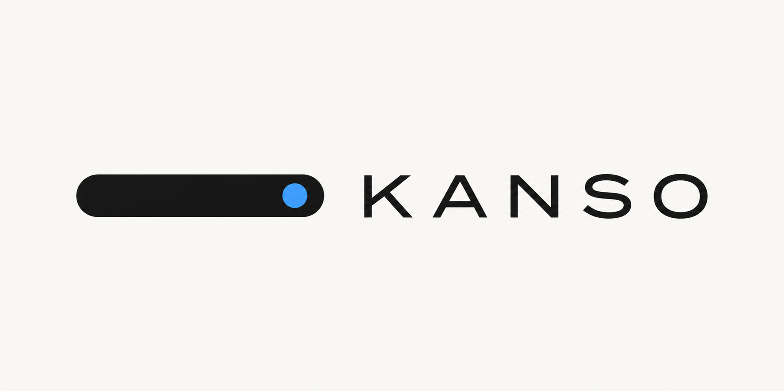
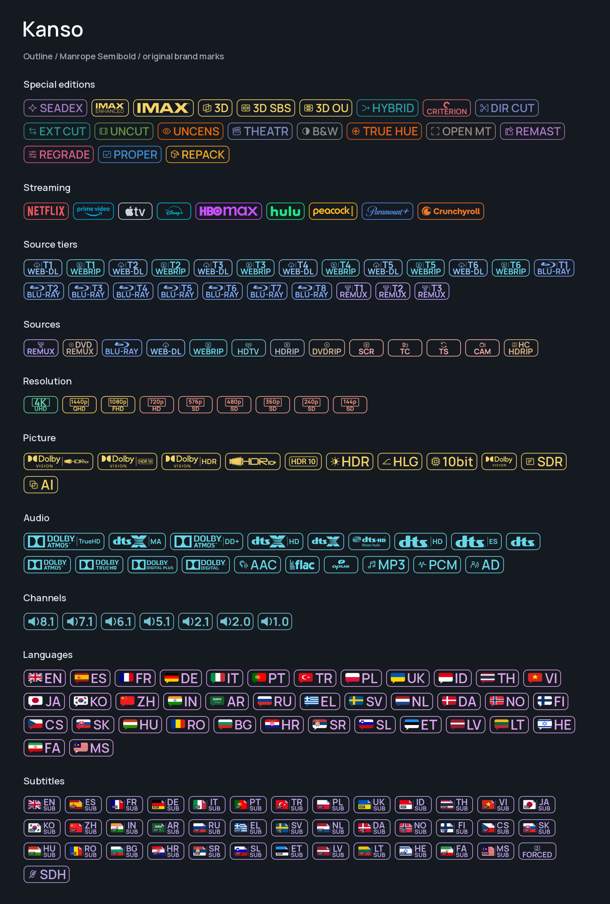

<p align="center"></p>

# Kanso 2.3.1

Instant-marker stream badges and a no-echo formatter for Nuvio + AIOStreams. **Every fact appears once:** chips own language, subtitles, channels, source and picture; encode sits beside the container as formatter text. Compact is the default. Detailed adds numbered tiers, streaming origin and provenance. Four skins: Solid, Transparent, Mono and Outline.

**Outline is the default appearance; Manrope Semibold is the default badge font.** Sourced brand marks sit alongside a complete custom glyph family, with shared height, stroke, corners and spacing. The custom direction was developed with imagegen and drawn as crisp production SVGs. Source files and per-badge provenance are documented in [the design notes](docs/badge-design.md). Matching uses Kanso Instant Unicode markers from structured AIOStreams fields, not filename regex.



This preview uses the generated badge PNGs. The [local gallery](badges/design/gallery.html) includes all four skins and an approximate native 20px view. Device rendering has not been verified. Kanso 2.3.1 replaces the previous badge appearance and formatter contract; use the matching install files below.

## Choose a matching pair

| Preset | AIOStreams formatter | Solid | Transparent | Mono | Outline |
|---|---|---|---|---|---|
| **Compact** | [formatter.json](https://raw.githubusercontent.com/nosvasedis/Kanso/main/formatter.json) | [Solid](https://gist.githubusercontent.com/nosvasedis/7abd79424bb8981b511838524c52f097/raw/kanso-solid.json) | [Transparent](https://gist.githubusercontent.com/nosvasedis/63b769d205bddbbef79faf8beef53c28/raw/kanso-transparent.json) | [Mono](https://gist.githubusercontent.com/nosvasedis/1858e332fef11d136f76c697ea6c7439/raw/kanso-mono.json) | [Outline](https://gist.githubusercontent.com/nosvasedis/0c3a88f4231dd17a249384e39cdbb127/raw/kanso-outline.json) |
| **Detailed** | [formatter-detailed.json](https://raw.githubusercontent.com/nosvasedis/Kanso/main/formatter-detailed.json) | [Solid Detailed](https://gist.githubusercontent.com/nosvasedis/7abd79424bb8981b511838524c52f097/raw/kanso-solid-detailed.json) | [Transparent Detailed](https://gist.githubusercontent.com/nosvasedis/63b769d205bddbbef79faf8beef53c28/raw/kanso-transparent-detailed.json) | [Mono Detailed](https://gist.githubusercontent.com/nosvasedis/1858e332fef11d136f76c697ea6c7439/raw/kanso-mono-detailed.json) | [Outline Detailed](https://gist.githubusercontent.com/nosvasedis/0c3a88f4231dd17a249384e39cdbb127/raw/kanso-outline-detailed.json) |

## Install or upgrade

1. Use **AIOStreams 2.36.0 or later**. Kanso 2 is verified against the official 2.36.0 engine. Older engines can lack the track operations this formatter needs.
2. In AIOStreams, select the custom formatter and import/sync the formatter URL for your preset, where supported. Alternatively paste its `name` and `description` separately. The exact paste strings are supplied in `formatter-export-name.txt` and `formatter-export-description.txt`, or their `formatter-detailed-…` equivalents.
3. Set your preferred audio languages in AIOStreams. Kanso reads those preferences.
4. In a Nuvio client that supports importing custom badge packs, **replace** the old Kanso pack with the matching **badge file** from the table. Merging with an old imported pack can leave retired entries behind. Each gist contains both presets: choose the correct filename. Turn off the old Kanso filters before importing so two versions cannot display together.
5. For an upgrade, **refresh both the formatter and the badge pack**. Kanso uses a version marker; mixed old/new exports are prevented from producing confident badges. Saving a URL does not guarantee the app has fetched the newest content—refresh its sync/import when needed.
6. On Nuvio TV, turn off its native file-size badges if you keep Kanso's `💾` size row. TV 1.0.0 enables native size badges by default; this app setting is separate from the imported pack.

Hosts may override the default template limit. Current default is **15,000 characters per field**. Compact is 12,459 / 12,550 characters; Detailed is 14,996 / 14,997. If a host rejects a template, check its engine version and configured limit. Do not truncate the templates.

## What each preset shows

| Information | Compact | Detailed |
|---|---|---|
| Title: transport emoji and stars | Yes | Yes |
| Debrid cache state: start of container/codec description row | Yes | Yes |
| Size, container, encode (`🎞️`), release group, addon/service | Yes | Yes |
| Warnings that have no chip (preferred audio missing, HDR/SDR conflict, upscaled, Bad-rule name, NZB health) | Yes | Yes |
| Resolution, source, picture, audio, channels chips | Yes | Yes |
| Preferred language chip | One preferred language | Up to four preferred tracks |
| Preferred subtitle chips | Preferred languages present on the file | Preferred languages present on the file |
| Specials (SeaDex, IMAX, 3D, Hybrid, Criterion, cuts, B&W, Proper, …) when evidenced | Yes | Yes |
| Known release tier | One source family chip | Numbered source-family/tier chip |
| Streaming origin | Hidden | Available |
| Bitrate, age, indexer, country | Hidden | When present |
| Seeders | Title, P2P or uncached only | Title, P2P or uncached only |
| Duplicate Best/Good/OK score badges | Hidden | Hidden |

Chips read left to right as specials (SeaDex, IMAX, 3D, Hybrid, Criterion, cuts, B&W, remaster/proper), then streaming origin, then numbered tier or generic source, then resolution, picture, audio, channels, language and subtitles. Encode is formatter text on the release row (`📦 MKV · 🎞️ HEVC · 👥 GROUP`), never a chip.

Changing the preset does not change AIOStreams sorting or ranking. Tiers are named rule/group classifications, not playback guarantees. Unknown tiers display one source badge. WEBRip is classified separately from WEB-DL. The title stars show AIOStreams relative expression score, not a guarantee of playback or objective file quality.

The detection library contains 201 definitions. The redesigned Compact exports 156 chips; Detailed exports 189, including six WEBRip tier variants. Language variants are consolidated into 38 display families in each audio/subtitle row. New reported-channel badges cover 1.0, 2.1 and 8.1; 8.1 no longer displays as 7.1. Best/Good/OK score chips, unranked family chips, MULTI language chips and encoder chips stay retired. No disabled placeholders or empty groups are exported.

## Accuracy and uncertainty

- **No inferred HDR from 4K REMUX.** Unknown range shows neither HDR nor SDR. Explicit SDR, HLG and supported DV/HDR combinations stay distinct. Conflicting SDR/HDR metadata produces a warning rather than simultaneous claims.
- Structured source/resolution information takes precedence. Limited filename fallbacks require bounded tokens and technical context; parsed title/release-group strings are removed from that fallback text.
- With audio tracks, Compact uses the **first usable matching track in file order** from your AIOStreams preferred-language context, excluding known commentary. The selected codec, channel and language chips belong to that same track. Detailed can show up to four matching preferred languages. Extra languages and subtitles on the file that are not in that preference list do not get chips. It does not guarantee the player will select that track.
- If the preferred language is unavailable, a warning replaces a misleading language/codec assertion. Unrecognized languages have no chip. The 48 detected identities map to 38 spoken/subtitle display families. ES groups Spanish variants, PT groups Portuguese variants, and IN groups the nine Indian languages for both audio and subtitles. IN is a family label; use the player to see the exact language. Preference selection still uses exact identities.
- Without track metadata, audio codec tags describe the **file**, not a guaranteed language/codec pairing. Without tracks, a language chip is used only with `probe` or `indexer` confidence. Channels, subtitles and source never also appear as formatter text. Encode is formatter-owned beside the container and is not truncated.
- Cache state is `⚡` cached, `⏳` uncached or `❔` unknown, at the start of the container/codec description row, and only for debrid streams. A dot follows only when another release field appears. Usenet, HTTP, P2P, live and other delivery types do not receive a cache cue. Bad sources and upstream health messages remain visible.
- A Netflix/Prime/etc. origin badge does not establish current subscription availability or regional rights.

## Tamtaro setup

The official Complete SEL Setup v3.2.9 was checked for this update. Its wizard puts your language choices, passthrough choices and fallbacks into AIOStreams’ language fields. Kanso reads the engine’s resolved preference context; `Original` can resolve to the media’s original language. Unresolved Original/Multi/Dubbed/Unknown placeholders do not become invented language chips.

Keep Kanso as the custom formatter when updating Tamtaro; changing the formatter does not alter Tamtaro’s SELs, sorting or stream ranking. Live user-profile settings were not changed or inspected. See [Tamtaro’s official changelog](https://github.com/Tam-Taro/SEL-Filtering-and-Sorting/blob/main/CHANGELOG.md).

## Appearance

Manrope Semibold gives generic badges a shared voice; small captions and tiers use Bold. Brand marks retain their own letterforms. Source icons sit above their captions to save horizontal space, and tiers use large, plain T1–T8 labels. Channels have a speaker. Spoken languages use speech-shaped flags with horizontal codes; subtitles use flag-filled documents behind a code stacked above SUB. All four skins share geometry. **Outline has colored words and glyphs matching the border; Transparent has white words and glyphs.** Flags retain real colors. Special editions keep distinct colors, and sources and their tiers share family hues. Picture uses gold, audio/channels cyan and languages/subtitles orchid/violet. Capture sources use coral. Solid uses category fill with contrasting ink; Mono uses white/black. Nuvio draws the border. The new channel contract requires the new formatter and pack together; mismatched old output fails closed.

The title begins with an invisible U+200E left-to-right anchor so Nuvio TV 1.0.0 cannot let a later hidden marker pick RTL alignment. HDR10+/HDR10/HLG suppress redundant generic HDR badges, and DTS Master Audio wins over generic DTS-HD. Structured audio tags cannot borrow a different codec from the filename.

Release-rule concerns display their specific matched name, such as `🚩 Bad Dual Groups`. Radarr/Sonarr prefixes are omitted. CAM, TS, TC and SCR are source chips, not formatter warnings. Conflicting HDR/SDR tags retain `⚠️`, upscaling retains `🔼`, and NZB health messages keep their status emoji and full details.

## Build, test and maintain

```sh
npm ci
npm run test:setup
npm run release
```

The setup clones the official AIOStreams **v2.36.0**, pinned to commit `ce6244454ee131bf0945b2bd6abc670a449b224d`, into ignored `.vendor/`. The release build is local and never uploads. It validates actual engine syntax/rendering and matching across 381 fixtures × two presets × four skins, plus all referenced PNG hashes and tier-sync regressions. No native playback/device compatibility claim is made by these tests.

Every exported badge has a positive real-metadata fixture. For native Java regex and Nuvio's exact first-strong direction semantics, run `node scripts/test-nuvio-java.mjs` with Java 21 or later; pass `--java=/path/to/java` to select an installed runtime. These checks do not substitute for testing your installed TV app or playback.

Maintainer publication, using the existing authorized GitHub CLI login for repository writes and a gist-capable token in `.env`:

```sh
npm run release:publish
```

Publication overlays a fresh checkout, preserves remote history/unrelated files, performs a non-force push, then updates the two files in each existing gist while preserving other gist files. It checks ownership and independently reads back uploaded content. Private config, tokens, vendor dependencies and recovery snapshots are excluded. `npm run verify:public` checks public formatter/pack/PNG bytes against local exports.

`npm run sync` opens the tier-group helper. Preview is read-only; applying a sync changes the tier oracle and regenerates both presets locally. Import or publish the newly built Detailed formatter to use those classifications. Patching/building no longer implicitly uploads gists.

## Recovery and references

For this migration, old local exports/scripts were saved under `backup/approved-20261013`. That recovery folder is private and not included in the public repository. Public users can retrieve the previous formatter, pack and PNG files from Git history; pair an old formatter with its matching old pack. Maintainer release records and pre-write gist revisions are saved privately in `docs/release-evidence/`.

See [release notes](docs/kanso-v2.md), the [AIOStreams formatter reference](https://docs.aiostreams.viren070.me/reference/custom-formatter/), [official AIOStreams source](https://github.com/Viren070/AIOStreams/tree/v2.36.0), [Nuvio repositories](https://github.com/NuvioMedia) and [kingsizew/badges](https://github.com/kingsizew/badges).
